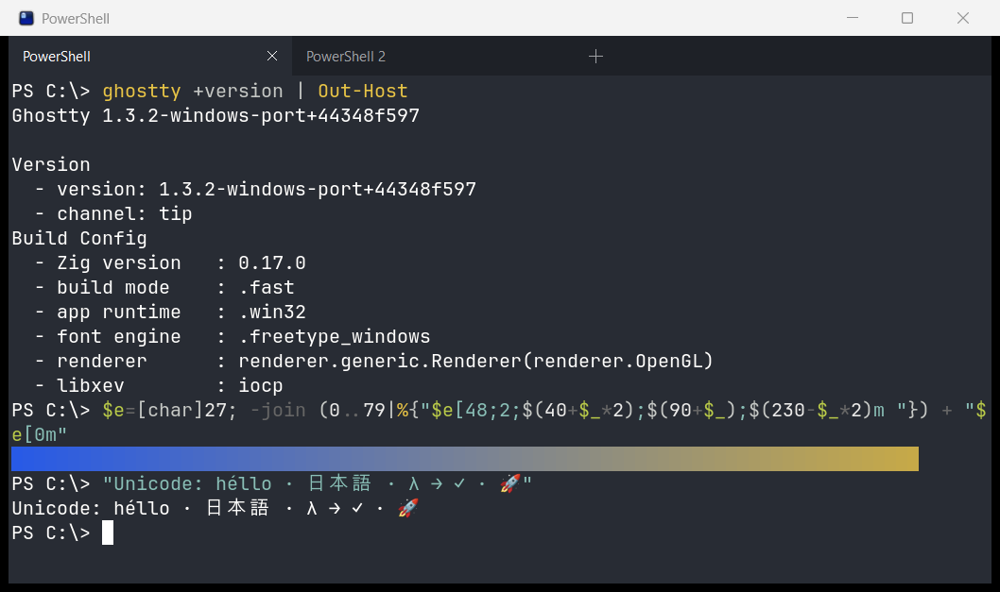

# Ghostty for Windows (unofficial port)

> **This is an unofficial port of [Ghostty](https://github.com/ghostty-org/ghostty)
> to native Windows.** Ghostty is created by
> [Mitchell Hashimoto](https://github.com/mitchellh) and the
> [Ghostty contributors](https://github.com/ghostty-org/ghostty/graphs/contributors),
> and nearly all of the code in this repository is theirs. This project is not
> affiliated with or endorsed by the Ghostty project. Please report problems
> with the Windows port in
> [this repository's issues](https://github.com/murr2k/ghostty-windows/issues),
> not to upstream Ghostty.



## What this is

Upstream Ghostty ships a native macOS app and a GTK app for Linux. On Windows,
upstream builds only `libghostty-vt`, its terminal-emulation library: the full
core did not compile for Windows and there is no application. This fork adds
the missing pieces so that building on Windows
(`zig build -Dtarget=x86_64-windows-gnu`, which `build-windows.cmd` runs)
produces a native `ghostty.exe`:

- **A Win32 application runtime** (`src/apprt/win32/`): windows, tabs,
  keyboard and IME input, mouse, clipboard, DPI scaling and the system theme,
  built directly on the Windows API (mainly `user32`, `gdi32`, `imm32` and
  `dwmapi`).
- **A WGL path in the OpenGL renderer** (`pkg/opengl/wgl.zig`,
  `src/renderer/OpenGL.zig`): each terminal gets an OpenGL 4.3 core context
  on its own window and presents with `SwapBuffers`. Other platforms keep
  their existing EGL and Metal paths.
- **Fixes to Windows-only code in the shared core** that had stopped
  compiling or misbehaved, such as a hang when a terminal closed
  (`src/termio/Exec.zig`).

Everything else (terminal emulation, the parser, fonts and shaping,
configuration, themes) is Ghostty's shared core. Its behavior is unchanged:
the only edits there add the new runtime to a few compile-time switches that
list every runtime, and keep `Shift+Insert` as a normal paste on Windows.

The port is based on upstream commit
[`22f100c63`](https://github.com/ghostty-org/ghostty/commit/22f100c63)
(October 2026).

## Status

This is an early port. It has been tested on one machine: Windows 11 Pro
(build 26200), NVIDIA GeForce RTX 2070, at 125% display scaling. Most of the
testing drove the app with key and mouse messages sent to its windows, with
the modifier keys set as held where needed, and checked the results with
window captures, a Debug-build state dump and logs. Those GUI tests are in
`test/windows/gui/` and run with `test\windows\gui\run.cmd`, on a hidden
desktop. The port has not yet had much use on a physical keyboard. Every
push to the port branch runs the unit tests and the GUI tests on a
self-hosted runner on the development machine
(`.github/workflows/windows-port-desktop.yml`); the GUI tests need an
OpenGL 4.3 driver, which GitHub's hosted runners lack. A manually started
workflow (`.github/workflows/windows-port.yml`) runs the builder on a clean
hosted Windows runner and then the unit tests.

**Tested and working**

- Shells through ConPTY: `cmd.exe` and PowerShell 7, including PSReadLine's
  colors.
- Rendering with exact colors, fallback fonts for CJK and symbols, and color
  emoji.
- Typing, Enter, Unicode text entry, mouse selection, copy and paste. On the
  test machine Ghostty draws the echo of a key about 1.5 ms after it
  receives the key.
- Ctrl and Alt shortcuts: `Ctrl+C` interrupting a running program,
  `Ctrl+Shift+A`/`C`/`V` to select all, copy and paste, `Shift+Insert` to
  paste, `Ctrl+Shift+T`, `Ctrl+Shift+W`, `Ctrl+Tab` and `Ctrl+PgUp` for tabs,
  `Ctrl+Shift+N` for a new window, `Alt+F4` to close the window,
  `Ctrl+Shift+Q` to quit.
- Tabs: a tab strip themed from your terminal colors, new tab (the `+`
  button or a keybinding), switching tabs (clicking or a keybinding), and
  closing a tab (its close button, a middle-click or a keybinding).
- Splits: `Ctrl+Shift+O` and `Ctrl+Shift+E` split the focused pane right
  and down, a pane closes with its shell (the last one closes the tab), and
  the tab shows the focused pane's title. `Ctrl+Shift+W` closes the whole
  tab, as in upstream's defaults; add `keybind = ctrl+shift+w=close_surface`
  to close just the focused pane, as Windows Terminal does. `goto_split`
  (`Ctrl+Alt+arrows`, and `Ctrl+Shift+[`/`]` for the previous and next
  pane), `toggle_split_zoom` (`Ctrl+Shift+Enter`, with a magnifier on the
  tab), `resize_split` (`Ctrl+Shift+Win+arrows`) and `equalize_splits`
  work, dividers can be dragged with the mouse (Esc cancels a drag, a
  double-click equalizes), unfocused panes are dimmed
  (`unfocused-split-opacity`, `unfocused-split-fill`), and
  `focus-follows-mouse` focuses the pane under the mouse.
- Close confirmations. `cmd.exe` and PowerShell don't mark their prompts, so
  Ghostty can't tell an idle prompt from a running program and asks whenever
  the shell is still running. Set `confirm-close-surface = false` to turn
  this off. Closing all windows asks too.
- OSC 52 clipboard writes with `clipboard-write = ask`: a burst of requests
  is confirmed one dialog at a time.
- Configuration errors: a dialog lists them at startup and after a reload,
  with Open Configuration, Reload and Ignore; reloading (`Ctrl+Shift+,`)
  applies a fixed file.
- Links (`Ctrl`+click a URL or an OSC 8 hyperlink). Web and mail links,
  folders, and files of plain data types (text, source code, images, media,
  PDF) open. Links from terminal output to programs, scripts, shortcuts,
  network paths or a few abused protocols are blocked, with the reason.
  Other files and protocols ask first, naming the program that would open
  them. Relative paths, and `file://` links that name this computer (as
  `ls --hyperlink` writes them), are blocked for now: Ghostty doesn't track
  the shell's directory on Windows yet.
- Resizing, the initial size from `window-width`/`window-height`, closing
  windows and tabs cleanly, quitting when the last window closes.
- CLI actions such as `ghostty +version` print to the console they were
  started from.

**Implemented but not yet tested**

- AltGr layouts, dead keys, IME composition (preedit and candidate window
  placement).
- Moving tabs (`Ctrl+Shift+PgUp`/`PgDn`), jumping to a tab (`Alt+1` to `Alt+8`, and `Alt+9` for the last tab), closing
  the other tabs or the tabs to the right (no default keys: bind
  `close_tab:other` or `close_tab:right`).
- Opening the config file (`Ctrl+,`) in the editor registered for it, else
  Notepad. The GUI tests check the request, not the editor appearing.
- Precision touchpad scrolling, mouse pointer shapes and hiding the pointer
  while typing, moving a window between monitors with different DPI.
- Title bar colors (`window-theme`). By default the caption takes the
  terminal's background and foreground, following programs that change them;
  `ghostty` uses `window-titlebar-background`/`-foreground`; `system`,
  `light` and `dark` use the system's caption. Caption colors need Windows
  11; Windows 10 gets a light or dark caption. The GUI tests check what
  Ghostty asks Windows for, not yet what appears on screen.
- Fullscreen (`Ctrl+Enter`), maximize, `window-show-tab-bar`, bell and paste
  protection.

**Not implemented yet**

- The right-click context menu. With the default
  `right-click-action = context-menu`, a right-click only selects the word
  under the cursor. Set `right-click-action = copy-or-paste` (copy if there is
  a selection, otherwise paste, as in Windows Terminal) or `paste` instead.
- Scrollbar, search, command palette, terminal inspector, quick terminal,
  desktop notifications.
- Transparency: with `background-opacity` the window stays opaque and shows
  the background color as configured. Also background blur and the
  `window-decoration` options.
- Dragging tabs with the mouse, and moving a tab to a new window. Dragging
  panes to rearrange splits.
- Sending commands to an already running instance (`ghostty +new-window`).

[WINDOWS_ROADMAP.md](../WINDOWS_ROADMAP.md) is the plan for the rest, starting
with shell integration and the working directory (Phase 2).

**Known issues**

- In a debug build, under bursts of synthetic input combined with the first
  load of a fallback font, the window twice kept showing an older frame until
  it was resized, even though the renderer was presenting new frames. It has
  not been reproduced since, including in release builds.
- Output of CLI actions run from `cmd` or PowerShell appears after the prompt
  returns, because shells don't wait for GUI programs to exit.
- Some modified keys never reach programs: `Shift+Enter`,
  `Ctrl+Shift+<letter>` and others that Ghostty sends as escape sequences
  Windows' ConPTY layer can't translate. Plain keys and `Ctrl+<letter>`
  work. The fix is win32-input-mode (roadmap 0.12).

## Requirements

- Windows 10 version 1809 or newer, or Windows 11, on x64. Windows 11 on ARM64
  should run the x64 build under emulation, but this has not been tested.
  Windows 10 on ARM cannot run x64 programs.
- A GPU driver with OpenGL 4.3 support. Most GPUs from the last decade have
  it; virtual machines and Remote Desktop sessions often don't. Without it
  Ghostty shows an error message and exits.

To build you also need an internet connection for the first build. Git is
optional: without it, or in a source tree that isn't a git checkout, the
version reads `<version>-dev+0000000` (pass `-Dversion-string=X.Y.Z` to set
it). Visual Studio and the Windows SDK are **not** needed: the build uses
Zig's bundled MinGW-w64 toolchain.

## Build

```powershell
git clone https://github.com/murr2k/ghostty-windows
cd ghostty-windows
.\build-windows.cmd
```

Clone into a short path, such as `C:\src\ghostty-windows`: some files in the
repository and in the Zig toolchain have long names.

`build-windows.cmd` runs `build-windows.ps1` with the Windows PowerShell 5.1
that ships with Windows, from `cmd`, PowerShell or a double-click. It:

1. Checks that the system is a supported 64-bit Windows.
2. Looks for the Zig version this source tree requires (read from
   `build.zig.zon`, currently 0.17.0) in the `ZIG` environment variable (the
   full path to `zig.exe`, or its folder), a previous download, or `PATH`. If none has it, it downloads Zig from
   [ziglang.org](https://ziglang.org/download/) into `.zig-toolchain\` inside
   the repository and verifies the archive's SHA-256. Nothing is installed
   system-wide and `PATH` is not changed.
3. Runs `zig build` and prints where `ghostty.exe` is.

The first build downloads Ghostty's dependencies (unpacked into `zig-pkg\` in
the repository, about 270 MB; Zig also keeps a per-user cache in
`%LOCALAPPDATA%\zig`) and takes several minutes. The result is
`zig-out\bin\ghostty.exe`. Keep `zig-out\share` next to `bin` if you move it:
it holds the themes and other resources Ghostty looks for. To keep a log of
the build, run `.\build-windows.cmd > build.log 2>&1`.

Options:

| Option | Effect |
|---|---|
| `-Optimize Debug` | Debug build (default `ReleaseFast`; also `ReleaseSafe`, `ReleaseSmall`) |
| `-Prefix <dir>` | Install into `<dir>\bin` instead of `zig-out\bin` |
| `-Target <triple>` | Zig target (default `x86_64-windows-gnu`) |
| `-Run` | Start Ghostty after a successful build |
| `-SetupOnly` | Install Zig, don't build |
| `-Clean` | Delete `.zig-cache`, and `zig-out` unless `-Prefix` is given, first (`zig-pkg\` and `.zig-toolchain\` are kept) |
| `-Help` | Show the help (also `-?` or `/?`) |

Every other argument is passed to `zig build`: `-D` options (written
`-Dname=value`), steps such as `test`, and flags such as `--summary all`. For
example `.\build-windows.cmd -Dstrip=false` keeps debug information in a
release build. From a PowerShell prompt, quote an argument that contains a
comma or a space (`'-Dname=a,b'`). The exceptions:

- `-h` and `--help` show the builder's help.
- `--verbose` (or `-Verbose`) is forwarded as `zig build --verbose`.
- `-Doptimize=`, `-Dtarget=` and `--prefix` aren't passed through: use
  `-Optimize`, `-Target` and `-Prefix`.
- Other single-dash words must be builder options. PowerShell accepts
  abbreviations of them, such as `-Opt`.
- A bare `--` is rejected. To pass arguments to Ghostty, build first and then
  run `zig-out\bin\ghostty.exe` with them.

To build by hand with Zig 0.17.0 already installed:

```powershell
zig build -Dtarget=x86_64-windows-gnu -Doptimize=ReleaseFast
```

## Run and configure

Start `zig-out\bin\ghostty.exe`, or build with `-Run`.

- **Configuration** lives in `%LOCALAPPDATA%\ghostty\config.ghostty` (or in
  `%XDG_CONFIG_HOME%\ghostty\` if that variable is set). Ghostty creates it as
  a commented template on first launch. Everything handled by Ghostty's
  shared core works as documented in the
  [configuration reference](https://ghostty.org/docs/config): fonts, colors,
  themes, keybindings, the shell and so on. Options that the macOS and GTK
  apps implement in their own user interface mostly have no effect here,
  besides the missing features listed above. Among them:
  `window-position-x`/`-y`, `window-save-state`, `window-new-tab-position`,
  `resize-overlay`, and the `title`, `audio` and `border` bell features (only
  `system` and `attention` work). Ghostty always opens a window at startup and
  always exits when its last window closes, whatever `initial-window` and
  `quit-after-last-window-closed` say.
- **Shell.** The default is `cmd.exe`, as in upstream Ghostty. For
  PowerShell 7 add `command = pwsh`. Shell integration isn't available for
  `cmd` or PowerShell (upstream doesn't support them either). A `SHELL`
  variable (from MSYS2 or Git Bash) is ignored.
- **Starting directory.** Started from a shell or another program, Ghostty
  opens in that program's directory; started from the Start menu, a shortcut
  or Explorer, in your home folder. `working-directory` overrides both.
- **Keybindings** are Ghostty's defaults for non-macOS platforms, for example
  `Ctrl+Shift+C`/`Ctrl+Shift+V` to copy and paste, `Ctrl+Shift+T` for a new
  tab, `Ctrl+Shift+W` to close it, and `Ctrl+Tab` or `Ctrl+PgUp`/`Ctrl+PgDn` to
  switch tabs. `ghostty +list-keybinds` prints them all. One addition:
  `Ctrl+Shift+[`/`]` go to the previous and next pane, because Windows can
  hold upstream's `Ctrl+Win+[`/`]` as system hotkeys, which then never reach
  Ghostty. Some Intel graphics drivers rotate the screen on
  `Ctrl+Alt+arrows`; if yours does, turn its hotkeys off in Intel Graphics
  Command Center (System, Hotkeys) or bind `goto_split` to other keys.
- **Mouse.** Middle-click doesn't paste by default: the default
  `middle-click-action = primary-paste` uses the selection clipboard of Linux,
  which Windows doesn't have. Set `middle-click-action = clipboard-paste` to
  paste the clipboard instead. For the right button, see `right-click-action`
  above.
- **Logs.** `ghostty.exe` is a GUI program, so it has no console. To see its
  log, start it from a shell with stderr redirected:
  `ghostty.exe 2> ghostty.log`.

## How it works

| Path | What |
|---|---|
| `src/apprt/win32.zig` | The runtime's entry point |
| `src/apprt/win32/App.zig` | Message loop, a message-only window for cross-thread wakeups, action dispatch, close requests |
| `src/apprt/win32/Window.zig` | Top-level window: tabs, size and DPI, fullscreen, close |
| `src/apprt/win32/TabBar.zig` | The tab strip, drawn with GDI using the terminal's colors |
| `src/apprt/win32/Tab.zig` | A tab: its terminal panes as a split tree, in a container window |
| `src/apprt/win32/Surface.zig` | One child window per terminal: keyboard, IME, mouse, clipboard |
| `src/apprt/win32/key.zig` | Scancode and text translation into Ghostty key events |
| `src/apprt/win32/console.zig` | Attaches to the parent console for CLI actions |
| `src/apprt/win32/url.zig` | Decides whether a link from terminal output opens, asks first or is blocked |
| `src/apprt/win32/c.zig` | Hand-written Win32 bindings |
| `pkg/opengl/wgl.zig` | Minimal WGL bindings and context creation |
| `src/renderer/OpenGL.zig`, `src/renderer/opengl/Device.zig` | WGL context per surface and `SwapBuffers` presentation on Windows |
| `build-windows.ps1`, `build-windows.cmd` | The builder |
| `test/windows/gui/`, `src/apprt/win32/test_hooks.zig` | GUI tests, and the Debug-only state dump they read |
| `.github/workflows/windows-port.yml` | CI, started by hand: the builder and the unit tests on a clean hosted Windows runner |
| `.github/workflows/windows-port-desktop.yml` | CI on every push: unit tests and GUI tests on the self-hosted runner |

Ghostty's embedding library (`include/ghostty.h`, the library the macOS app
links) also gains a Windows platform (`GHOSTTY_PLATFORM_WINDOWS`, which takes
an `HWND`), so a native program could host a Ghostty surface. This is
untested, and upstream treats the library's API as internal and unstable.
`zig build -Dtarget=x86_64-windows-gnu -Dapp-runtime=none` builds it as
`zig-out\lib\ghostty-internal.dll`.

A few rules the code depends on:

- Windows and tabs are only closed from the message loop: never inside a
  callback from Ghostty's core, which may still be using them, and never
  while a confirmation dialog is open, since a dialog runs a nested message
  loop. Close requests are queued and run when it is safe.
- Every link Ghostty's core asks to open is accepted, even one that is then
  blocked. Declining one would make the core open it with its generic opener,
  which opens anything.
- Pipe handles on Windows are `HANDLE`s, not C runtime file descriptors: use
  `WriteFile` and `CloseHandle`, not `write()` and `close()`.
- A key-down message only takes the `WM_CHAR` messages queued directly behind
  it, so text is never attached to the wrong key.
- The window's pixel format is sRGB-capable and `GL_FRAMEBUFFER_SRGB` is on
  during the final blit, which keeps colors exact.

The commit messages on the `windows-port` branch explain each change in more
detail.

## Branches and upstream

`windows-port` (the default branch) is the port: upstream Ghostty's history up
to the base commit above, plus the commits that add Windows support. Upstream
itself is [ghostty-org/ghostty](https://github.com/ghostty-org/ghostty).

The port is meant to stay a small set of commits on top of upstream, rebased
as upstream moves. It has not been submitted to upstream Ghostty.

## AI assistance

This port was developed by the repository owner using Claude Code
(Anthropic's AI coding agent): at the owner's direction, the agent wrote the
code, the commit messages and this README, and ran the testing described
under Status. Ghostty's [AI usage policy](../AI_POLICY.md) governs contributions
to Ghostty itself; this fork has not been submitted upstream, and any future
upstream contribution would have to meet that policy.

## License

Ghostty is released under the MIT License, and so is this port: see
[LICENSE](../LICENSE), copyright Mitchell Hashimoto and the Ghostty contributors.
The changes in this repository are released under the same license.

"Ghostty" and its logo belong to the Ghostty project. The name is used here
only to identify the software this port is based on.

Upstream's README is the repository's root [README.md](../README.md), unchanged;
this page is `.github/README.md`, which GitHub shows instead. Its
download, support, contributing and crash-reporting instructions are for
upstream Ghostty and don't apply to this port, and the same goes for the other
upstream documents such as [CONTRIBUTING.md](../CONTRIBUTING.md),
[HACKING.md](../HACKING.md) and [AI_POLICY.md](../AI_POLICY.md). Report problems
with the port in
[this repository's issues](https://github.com/murr2k/ghostty-windows/issues).
